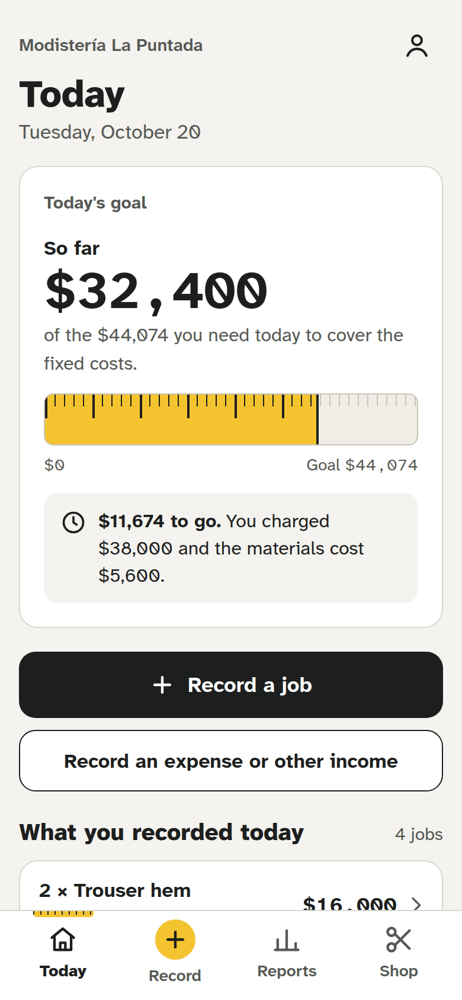
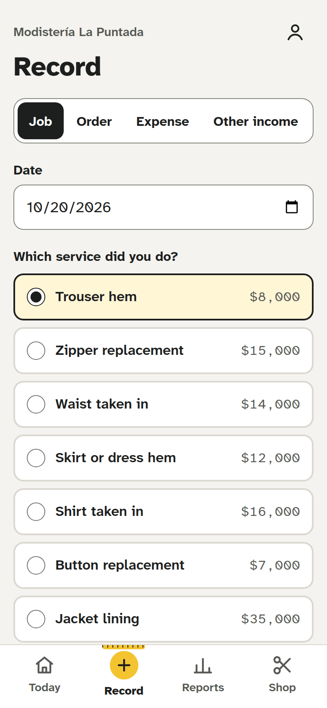
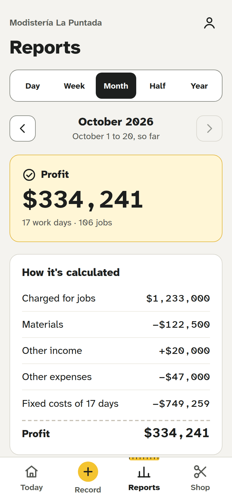
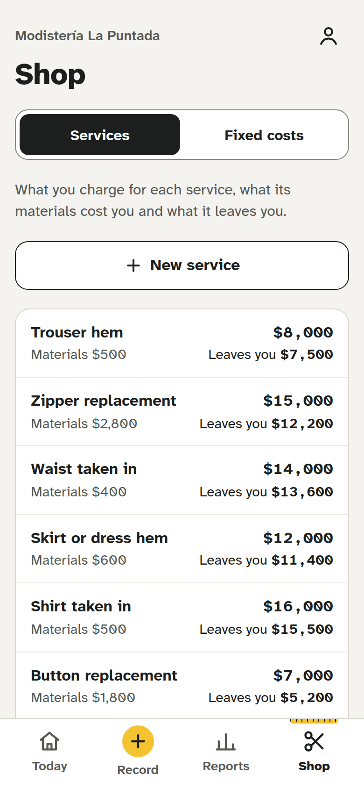

# Tailor Shop Ledger

A Ruby on Rails app that shows small tailoring and alteration shops whether their work pays. A shop records the services it offers, with their price and material cost; the jobs it charges for, and the orders customers pay for in parts; its fixed costs, occasional expenses and other income. The app turns that into a goal for the day and results by day, week, month, semester and year.

<p align="center">
  
  
  
  
</p>

<p align="center"><em>Today, Record, Reports and Shop, with the demo seeds on Tuesday, October 20, 2026. Shops see it in Spanish.</em></p>

## Who it's for

Small shops in Colombia that do alterations, sewing and dressmaking. One person runs each, alone and usually at home, working as customers bring garments in. They write their work down in a notebook and have never kept accounts, so costs are what they struggle with. Most of them only have an Android phone.

So the app is built for that phone first: large type, 44 px touch targets, a numeric keyboard on every money field, and an icon on the home screen. Several shops share one installation, each with a single user who never sees another shop. It runs at taller.yunquelabs.com, where the operator creates each shop, and its first shop started using v0.1.0 in October 2026. There's no public demo, but the demo seeds below build one locally.

## The accounting rules

The rules are the product. Three of them keep a shop from fooling itself:

- **Materials count once, inside each job.** A job carries the materials it used, copied from its service and set to 0 when the customer brings them. Buying thread or zippers is never recorded as an expense, or it would count twice.
- **Fixed costs are spread over the days the shop works.** Rent, electricity or a phone plan are monthly amounts, and each work day carries the month's total divided by its work days: that share is the day's goal on Today. Charging the rent on the day it's paid would show that day as a loss and every other one with an inflated profit.
- **The home's accounts stay out.** When the shop is in the home, only the shop's share of the home's bills goes into fixed costs, and money that isn't the shop's, like the rent of a room, isn't other income. The help texts explain it with an example.

A period's result is what its jobs charged, less their materials, plus other income, less other expenses and the fixed costs of its work days: a profit from 0 up, a loss below.

Work a customer pays for later goes in an order: usually a deposit when they leave it, which covers its materials, and the rest when it's done. Each payment counts the day it comes in, and the order's materials and jobs the day it was left, so a day's figures follow the money that actually came in. Today also lists what customers still owe. An order that's cancelled is deleted, since the deposit goes back.

Changing a service's price never changes the jobs already recorded, and a new amount for a fixed cost applies from a month on, never to the months before it. The full rules are in [docs/plan.md](docs/plan.md).

## Stack

- Ruby 4.0 and Rails 8.1 with its defaults: Hotwire (Turbo and Stimulus), Propshaft, importmap, and Solid Queue, Cache and Cable on PostgreSQL 17. No Node and no Redis.
- Tailwind CSS through tailwindcss-rails, with the Atkinson Hyperlegible fonts self-hosted.
- Rails' authentication generator, and acts_as_tenant on every table a shop owns, so a request only ever sees the signed-in user's shop.
- RSpec, FactoryBot, and Capybara driving headless Chrome at a phone's size; RuboCop and Brakeman, all in GitHub Actions.
- Kamal on a VPS, a nightly `pg_dump` to Cloudflare R2 watched by Healthchecks.io, and Sentry for errors.

Business rules live in service objects (`app/services`), the results of a period in query objects (`app/queries`), and each page that gathers data from several places in a facade (`app/facades`). Controllers and views only find records, render and redirect.

## Running it locally

You need Ruby 4.0.7 (pinned in `.ruby-version`), PostgreSQL 17, and Chrome for the system specs.

```sh
bin/setup            # gems and databases, then bin/dev on http://localhost:3000
bin/rails db:seed    # wipes the database and builds the two demo shops
```

Sign in as `ana@demo.test`, a shop with six months of history, or `rosa@demo.test`, a shop in a home with one month; both use the password `costura-demo`. The seeds are relative to today and go through the app's own services, so they can't break its rules.

The interface comes in English and Spanish, one per installation: `APP_LOCALE=es-CO bin/dev` shows it as the shops see it, and `APP_LOCALE=es-CO bin/rails db:seed` names the demo services, costs and expenses in Spanish.

## Tests

```sh
bin/rails spec    # builds the Tailwind CSS, then runs RSpec
bin/ci            # everything CI runs: RuboCop, Brakeman, the audits, the specs and the demo seeds
```

Isolation between shops is the only authorization there is, so request specs prove that a user of one shop gets a 404 for another shop's records.

## Deploy

[docs/deploy.md](docs/deploy.md) covers the server, DNS, Kamal, creating shops and their passwords, backups, restoring one, and monitoring.

## License

[GNU Affero General Public License v3.0](LICENSE). The Atkinson Hyperlegible fonts in `app/assets/fonts` are under the [SIL Open Font License](app/assets/fonts/OFL.txt).
